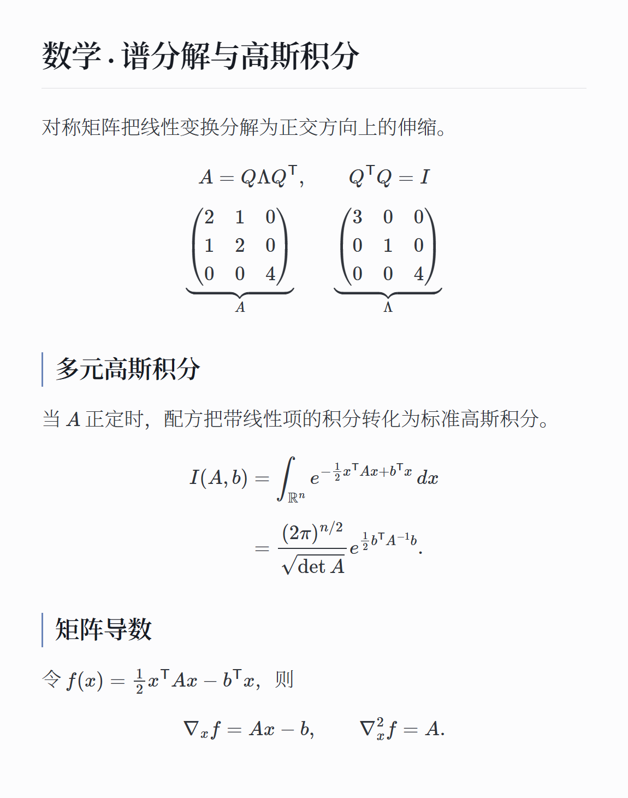
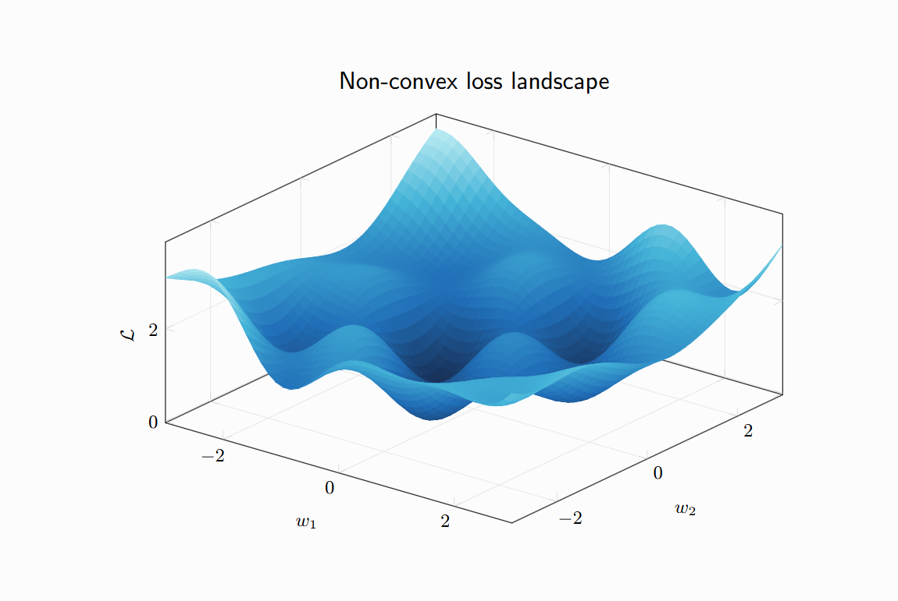
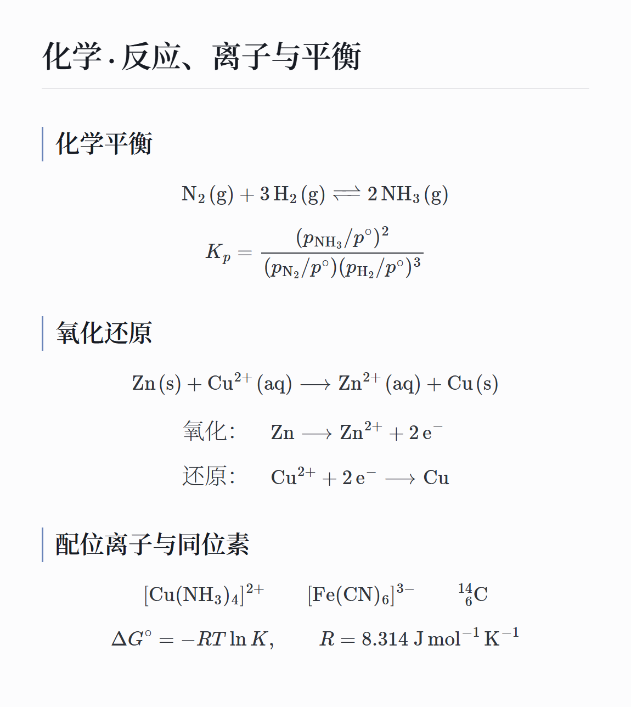
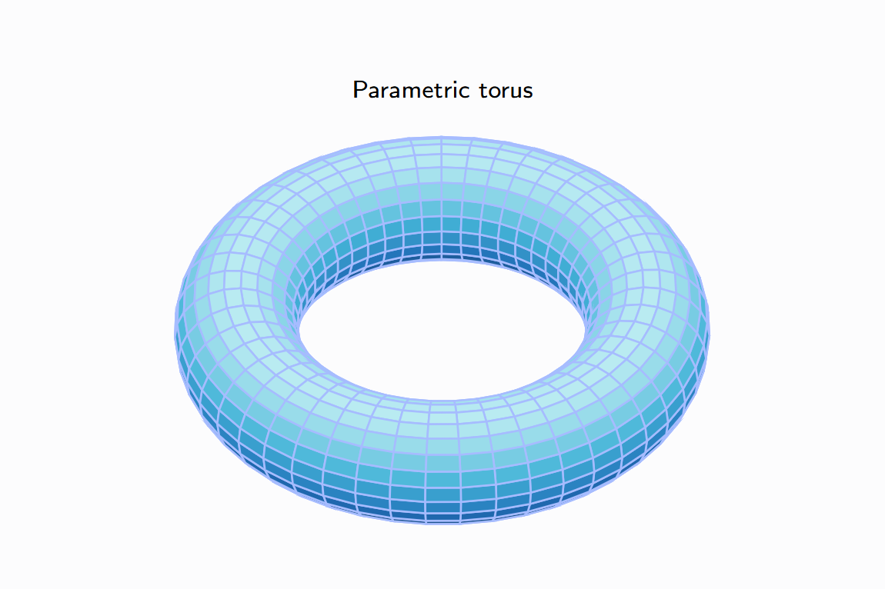
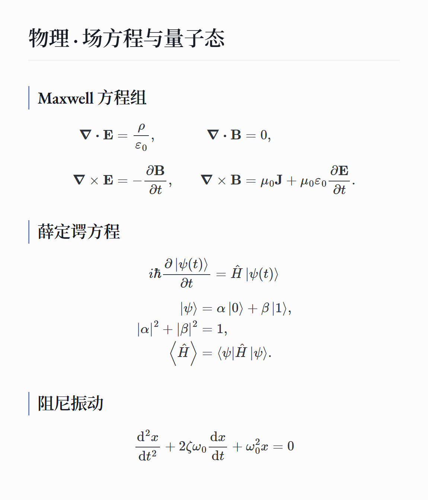
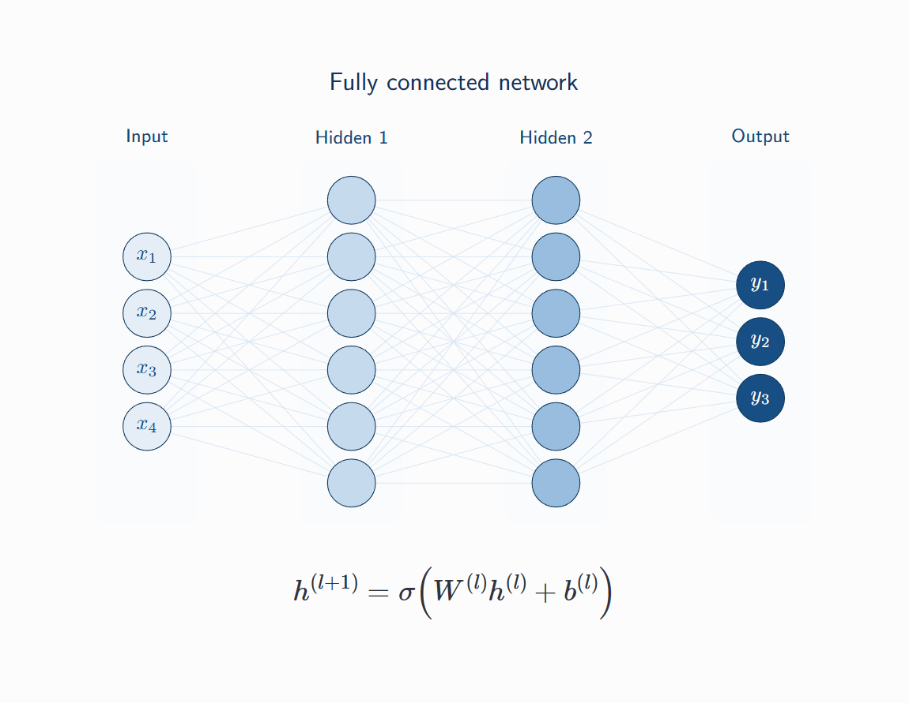

# MathJax2Image

将 Markdown、LaTeX 公式、TikZ / PGFplots 图形与 Mermaid 图表渲染为高清 PNG 的 AstrBot 插件。

[效果展示](#效果展示) · [安装](#安装) · [命令与工具](#命令与工具) · [宏包与绘图](#宏包与绘图) · [配置](#配置)

> 喜欢的话可以点个 Star 喵，有问题欢迎提 Issue / PR。

## 核心特性

- **科学公式排版**：基于 MathJax 3.2，预置代数、微积分、线性代数与概率统计常用宏，支持 `physics`、`mhchem` 等扩展包。
- **二维与三维绘图**：支持 TikZ / `tikz-cd` 图形、PGFplots 三维曲面（Python 预计算采样点）以及 Mermaid 流程图（支持节点内 `$...$` 公式与中文混排）。
- **结构化文档渲染**：支持多级标题、引用、三线表与带语法高亮和行号的代码块，可自定义背景色、字号、行高与标题比例。
- **命令与大模型双入口**：提供 `/render`、`/math`、`/art` 指令，同时注册 `render_math` 工具供大模型在对话中自动调用出图。
- **常驻引擎与双层缓存**：隔离页面池按需加载并复用 MathJax / TikZ WASM 引擎，静态资源使用内存 + 磁盘缓存，空闲自动回收页面。

## 效果展示

点击各示例标题可查看对应 Markdown / LaTeX 源码；标题、正文、公式、三线表与代码块混排效果可查看[综合排版源码](examples/editorial.md)与[渲染预览](examples/editorial.png)。

| 公式与排版 | TikZ 绘图 |
| --- | --- |
| [数学：谱分解、高斯积分与矩阵导数](examples/math.md)<br> | [非凸损失曲面：48 × 48 采样](examples/ml_surface.md)<br> |
| [化学：反应、离子与平衡](examples/chemistry.md)<br> | [参数圆环：48 × 24 采样](examples/torus.md)<br> |
| [物理：场方程、量子态与阻尼振动](examples/physics.md)<br> | [全连接网络：4–6–6–3](examples/neural_network.md)<br> |

## 安装

```bash
pip install -r requirements.txt
python -m playwright install chromium --only-shell
```

Linux 环境建议在部署阶段安装系统依赖：

```bash
playwright install-deps chromium
```

首次渲染需联网拉取固定版本的 MathJax、TikZJax、Mermaid 与字体资源，后续自动从本地磁盘缓存复用。

<details>
<summary>可选：配置 TinyTeX / TeX Live 原生 TikZ 后端</summary>

默认 `tikz_backend = wasm` 无需安装本地 TeX。对重型三维曲面有更高速度需求时，可切换为 `native`（**pdfTeX → DVI → dvisvgm → SVG**，普通公式仍由 MathJax 渲染）：

1. 安装 [TinyTeX](https://yihui.org/tinytex/) 或使用现有 TeX Live，补齐绘图包：
   ```bash
   tlmgr option docfiles 0
   tlmgr option srcfiles 0
   tlmgr install latex-bin standalone pgfplots amsmath amsfonts dvisvgm dvips infwarerr ltxcmds iftex
   ```
2. 在插件配置中将 `tikz_backend` 设为 `native`，`native_tex_bin` 填写包含 `latex` 与 `dvisvgm` 的可执行目录（留空则从 `PATH` 查找），重载插件生效。

缺少依赖或编译超时会自动回退至 WASM。原生 TeX 为本机进程，虽已禁用 shell-escape 并过滤文件/进程指令，接收不可信输入时仍建议运行在无敏感挂载的低权限容器中。

</details>

## 命令与工具

### 聊天命令

| 命令 | 说明 | 示例 |
| --- | --- | --- |
| `/render <内容>` | 直接将 Markdown / LaTeX / TikZ / Mermaid 渲染为图片 | `/render $E=mc^2$ 是质能方程` |
| `/math <主题>` | 调用 LLM 撰写带公式/图形的数学科普长图 | `/math 勾股定理的证明` |
| `/art <主题>` | 调用 LLM 撰写结构化文章并渲染长图 | `/art 快速排序的核心思想` |

### LLM 函数工具

- `render_math`：对话涉及分式、积分、矩阵、多步推导或函数/流程图形时，大模型可将完整 Markdown 传入该工具直接生成图片发送，避免聊天框裸露 LaTeX 源码。
- `send_image`：仅在 `render_math(..., auto_send=false)` 预渲染模式下用于补发最近一张待发送图片。

## 宏包与绘图

### MathJax 扩展包

常用命令（如 `\ce{H2O}`、`\cancel{x}`）支持自动加载，也可在正文前显式声明：

```latex
\usepackage{physics,mhchem,cancel,upgreek,centernot}
$$\dv[2]{x}{t} + \pdv{f}{x}, \qquad \ce{2H2 + O2 -> 2H2O}$$
```

- **支持清单**：`ams`、`amscd`、`bbox`、`boldsymbol`、`braket`、`cancel`、`cases`、`centernot`、`color`、`empheq`、`enclose`、`extpfeil`、`gensymb`、`mathtools`、`mhchem`、`newcommand`、`physics`、`textcomp`、`textmacros`、`unicode`、`upgreek`、`verb`。
- **常用别名**：`amsmath` / `amsfonts` / `amssymb` → `ams`，`bm` → `boldsymbol`，`xcolor` → `color`。
- **注意**：`physics` 与 `braket` 语法冲突不可同时声明；不在清单内的无选项 `\usepackage{...}` 会自动忽略，带选项的 `\usepackage[...]{...}` 会报错提示。

### TikZ / PGFplots 与 Mermaid

常用库会自动识别加载，也可在 `tikzpicture` 内显式声明 `\usepackage` 与 `\usetikzlibrary`：

- **可加载宏包（17 个）**：`amsbsy`、`amsfonts`、`amsgen`、`amsmath`、`amsopn`、`amssymb`、`amstext`、`array`、`etoolbox`、`expl3`、`hf-tikz`、`ifthen`、`pgfcalendar`、`pgfplots`、`tikz-3dplot`、`tikz-cd`、`xparse`。
- **Mermaid 公式标签**：Flowchart 双引号节点与边标签支持中文与行内公式混排（如 `A["输入 $x$"]`）。
- **使用边界**：不支持 `circuitikz`、`chemfig`、`siunitx` 及外部文件读写；TikZ 节点内请使用英文或 `$...$` 数学符号（中文说明写在图外 Markdown 正文）；三维曲面建议使用 `shader=flat` 或 `shader=faceted`。

<details>
<summary>展开完整 TikZ 库清单（75 个）</summary>

`3d`、`angles`、`animations`、`arrows`、`arrows.meta`、`automata`、`babel`、`backgrounds`、`bending`、`calc`、`calendar`、`cd`、`chains`、`circuits`、`circuits.ee`、`circuits.ee.IEC`、`circuits.logic`、`circuits.logic.CDH`、`circuits.logic.IEC`、`circuits.logic.US`、`datavisualization`、`datavisualization.3d`、`datavisualization.barcharts`、`datavisualization.formats.functions`、`datavisualization.polar`、`datavisualization.sparklines`、`decorations`、`decorations.footprints`、`decorations.fractals`、`decorations.markings`、`decorations.pathmorphing`、`decorations.pathreplacing`、`decorations.shapes`、`decorations.text`、`er`、`fadings`、`fit`、`fixedpointarithmetic`、`folding`、`fpu`、`graphs`、`graphs.standard`、`intersections`、`lindenmayersystems`、`math`、`matrix`、`mindmap`、`patterns`、`patterns.meta`、`perspective`、`petri`、`plothandlers`、`plotmarks`、`positioning`、`quotes`、`rdf`、`scopes`、`shadings`、`shadows`、`shapes`、`shapes.arrows`、`shapes.callouts`、`shapes.gates.logic.IEC`、`shapes.gates.logic.US`、`shapes.geometric`、`shapes.misc`、`shapes.multipart`、`shapes.symbols`、`snakes`、`spy`、`svg.path`、`through`、`trees`、`turtle`、`views`。

</details>

## 配置

在 AstrBot 插件配置页修改并重载插件生效（仓库另保留可选参考模板 [book.html](templates/book.html)，来源与字体许可见 [NOTICE](templates/NOTICE.md)）。

### 排版与生成

| 参数 | 默认值 | 说明 |
| --- | --- | --- |
| `llm_settings.provider_id` | 空 | `/math` 与 `/art` 使用的模型提供商，留空跟随当前会话 |
| `background_color` | `#FCFCFD` | 页面十六进制背景色 |
| `typography.body_font_size` | `36` | 正文字号（px，范围 16–64） |
| `typography.h1_scale` / `h2_scale` / `h3_scale` | `1.55` / `1.25` / `1.10` | 一至三级标题相对正文的字号倍率 |
| `typography.line_height` | `1.7` | 正文行高倍数（范围 1.2–2.2） |
| `math_system_prompt` / `article_system_prompt` | 内置提示词 | `/math` 与 `/art` 的系统提示词 |

### 绘图与超时限制

| 参数 | 默认值 | 说明 |
| --- | --- | --- |
| `tikz_backend` | `wasm` | TikZ 编译后端（`wasm` 或 `native`） |
| `native_tex_bin` | 空 | `native` 模式下 `latex` 与 `dvisvgm` 所在目录 |
| `precompute_pgfplots` | `true` | 在 Python 侧预计算可识别的 `addplot3` 网格坐标 |
| `plot_max_points` | `6400` | 单篇文档三维采样点预计算总预算（2D `draw plot` 上限为单条 2000 点 / 单篇 4000 次） |
| `max_concurrent_tikz` | `1` | 同时编译的重型 TikZ 任务上限 |
| `mathjax_timeout` / `mermaid_timeout` / `tikz_timeout` | `10000` / `15000` / `60000` | 各引擎渲染超时（毫秒） |
| `fail_on_mathjax_timeout` | `false` | 开启后公式超时将直接报错而非降级出图 |
| `max_screenshot_height` / `max_screenshot_pixels` | `16000` / `40000000` | 截图最大高度（px）与总像素上限 |

### 浏览器池与缓存

| 参数 | 默认值 | 说明 |
| --- | --- | --- |
| `browser_engine` | `chromium` | 浏览器内核（`chromium` / `firefox` / `webkit`） |
| `browser_cdp_url` / `allow_remote_cdp` | 空 / `false` | 连接外部共享 Chromium CDP 地址（默认仅允许本机回环地址） |
| `resident_engines` | `true` | 兼容任务间常驻复用 MathJax / TikZ 引擎 |
| `browser_max_pages` / `max_concurrent_renders` | `2` / `2` | 页面池上限与并发渲染数（实际并发取较小值） |
| `max_queued_renders` / `render_queue_timeout` | `8` / `30000` | 排队容量上限与排队超时（毫秒） |
| `browser_max_idle_pages` / `browser_idle_timeout` | `1` / `30` | 空闲保留页面数与空闲回收时间（秒，`0` 关闭定时回收） |
| `resource_cache_max_mb` / `asset_disk_cache_max_mb` | `64` / `256` | 静态资源内存缓存与磁盘持久化缓存上限（MiB，`0` 关闭） |
| `image_cache_max_mb` | `8` | 近期渲染结果图片缓存上限（MiB，`0` 关闭） |
| `auto_install_browser` | `false` | 浏览器缺失时是否在运行时自动执行安装 |

<details>
<summary>开发与基准测试脚本</summary>

重新生成展示图或在本机评估吞吐与内存（压测脚本需额外安装 `psutil`、`Pillow`）：

```bash
python scripts/render_showcase.py
python scripts/benchmark_rendering.py --output ./benchmark-output --runs 5 --unique
python scripts/benchmark_concurrency.py --output ./concurrency-output --jobs 12 --concurrency 1 2 4
python scripts/benchmark_memory.py --tikz --output ./memory-tikz-output
python scripts/benchmark_heavy.py --output ./heavy-output --cases dense-curve surface-25 surface-40 torus
```

</details>

## 致谢

- [MathJax](https://www.mathjax.org/) — 数学公式渲染引擎
- [TikZJax (@drgrice1/tikzjax)](https://github.com/drgrice1/tikzjax) / [obsidian-tikzjax](https://github.com/artisticat1/obsidian-tikzjax) — WebAssembly TikZ 编译支持
- [Mermaid](https://mermaid.js.org/) — 流程图与时序图渲染引擎
- [BaKoMa Fonts](https://ctan.org/pkg/bakoma-fonts) — TeX 数学字体
